# TP2 answers

## Exercise 1
(a) pull_request runs the pipeline on a proposed change BEFORE it reaches
main, and shows the result on the pull request. With the required check
it can block the merge. push only runs after the code is already on the
branch, so it cannot stop anything.

(b) Lint is fast and cheap and catches simple mistakes (style, syntax) in
seconds. If it fails, there is no point running the slower tests: the
pipeline gives feedback quickly (fail fast).

(c) With a 20-minute test suite, a failure found by lint after a few
seconds saves 20 minutes of waiting and of runner time. With a 3-second
suite the saving is tiny, so the order matters much more for slow suites.

## Exercise 2
(a) git commit --no-verify (short form: git commit -n)

(b) Only a repository admin/owner. The rule does not allow bypassing, so
the check and the review are enforced even for admins. But an admin can
still edit or switch off the branch protection rule in Settings, and then
push a secret straight to main. So the protection depends on trusting
the admins.

## Exercise 3
(a) Error line from the failing run (tests step, PR #7, branch tmp/no-install):

    ModuleNotFoundError: No module named 'scoreboard'
    (tests/conftest.py:17: from scoreboard.app import create_app;
    Error: Process completed with exit code 4)

(b) The project uses a src layout: the code is in src/scoreboard, not in
the root folder. Python does not look in src/, so the package only
becomes importable after `pip install -e .` installs it (editable) in
the environment. Without that line, the import fails.

(c) `make install` ran it for me (its Makefile runs `pip install -e .`).
My Windows machine has no make, so I ran the same pip commands by hand.

## Exercise 4
The diagnosis table (also in docs/TP2_diagnosis.md, committed in
2a02723 before the four fix commits):

# TP2 diagnosis (from the pipeline log only)

Team name used with the seed script: `devops-5ENG-FirstTeam`

| Defect | Gate that failed | Name in the log | One-line cause |
|---|---|---|---|
| Test 1 | tests | `tests/test_api.py::test_submitting_for_an_unknown_team_is_not_found` (fails by exception: `AttributeError: 'NoneType' object has no attribute 'id'`) | The code reads `.id` on `None` when the team does not exist, instead of answering "not found". |
| Test 2 | tests | `tests/test_scoring.py::test_last_solve_time_is_the_most_recent_not_the_last_added` (fails by assertion: `AssertionError`) | The function returns the last added solve (12:05) instead of the most recent one (12:30). |
| Credential | secret scan | `leaks found: 2` (the log does not print the rule or the file: gitleaks runs without `--verbose`) | Two strings that look like credentials are present in the files of the branch. |
| Dependency | dependency audit | `idna` 3.6: PYSEC-2024-60 and PYSEC-2026-215 | The pinned version of `idna` has known vulnerabilities; the fixes are in 3.7 and 3.15. |

## Exercise 5
Fix commits (git revert of the four seeded commits), after the diagnosis:
c92ff59, 68d1910, ef9cc60, 053f84d. Result: 73 tests passed, ruff clean,
and the pipeline on PR #8 is green.

(a) The vulnerable package is idna. It is a TRANSITIVE dependency: the
project does not use it directly. It is installed because anyio, httpx
and requests depend on it. The seeded defect only pinned it (idna==3.6,
vulnerable) in requirements.txt.

(b) Command used: pip show idna
The "Required-by" line lists anyio, httpx, requests.

## Screenshots
All images are in docs/screenshots/. Screenshots 01 to 07 were taken
afterwards, because the terminal was closed: the commands were run again.
Screenshots 08 to 15 are the original ones taken during the lab.

- 01-git-log.png: git log --oneline -8 (diagnosis commit is below the reverts)
- 02-git-show-stat.png: git show --stat of the four revert commits
- 03-pytest.png: python -m pytest -q (73 passed)
- 04-ruff-check.png: ruff check .
- 05-ruff-format.png: ruff format --check .
- 06-pip-show-idna.png: pip show idna
- 07-git-status.png: git status
- 08-partC-tests-error.png: Part C, failing tests step (ModuleNotFoundError)
- 09-partC-run-annotations.png: Part C, failed run page
- 10-partC-pr7-blocked.png: Part C, PR #7, merge blocked by the required check
- 11-partC-pr7-closed.png: Part C, PR #7 closed (not merged)
- 12-partD-dependency-audit.png: Part D, pip-audit finds idna 3.6
- 13-partD-secret-scan.png: Part D, gitleaks: leaks found: 2
- 14-partD-tests.png: Part D, 2 failed, 71 passed
- 15-partD-terminal-before-fix.png: Part D, commands run before the fix commits

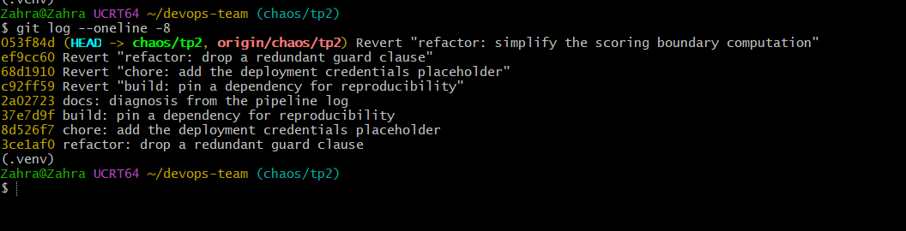
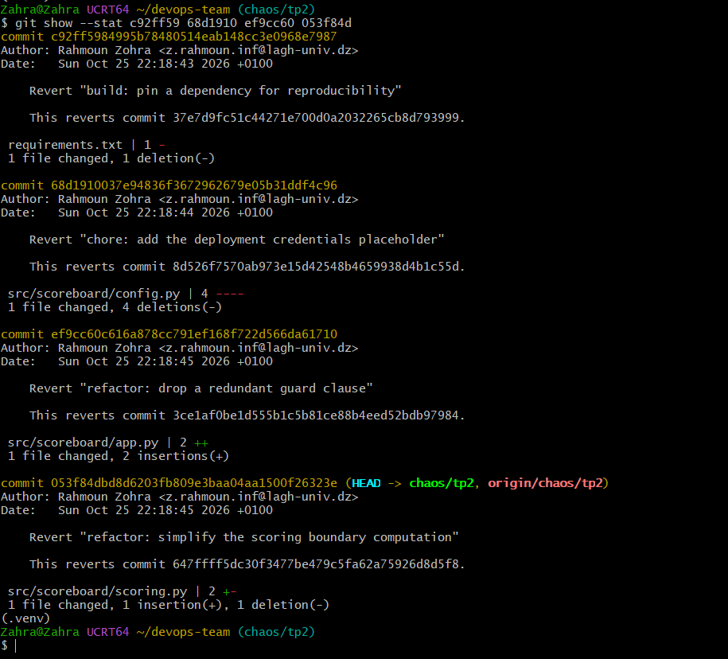
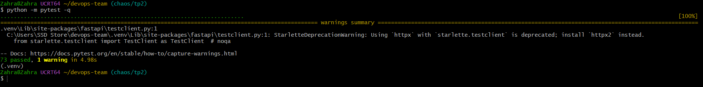
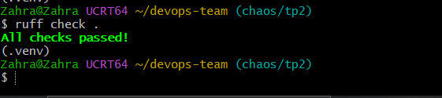
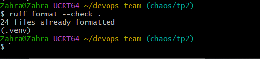
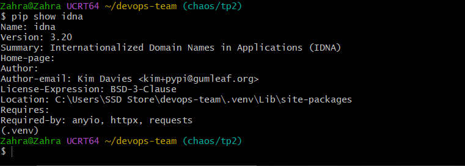
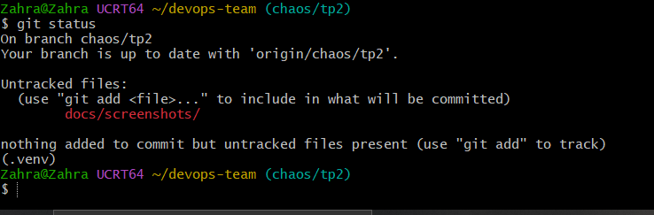
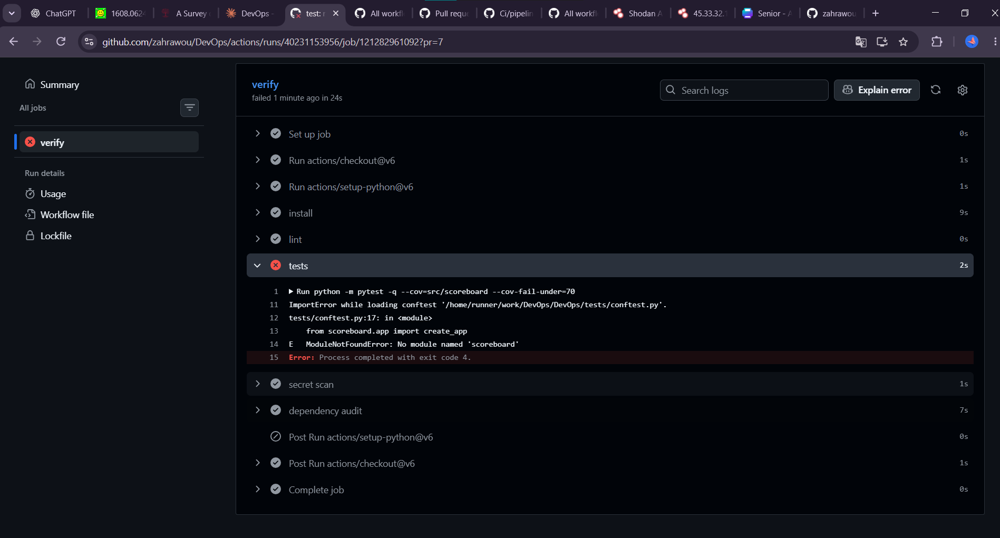
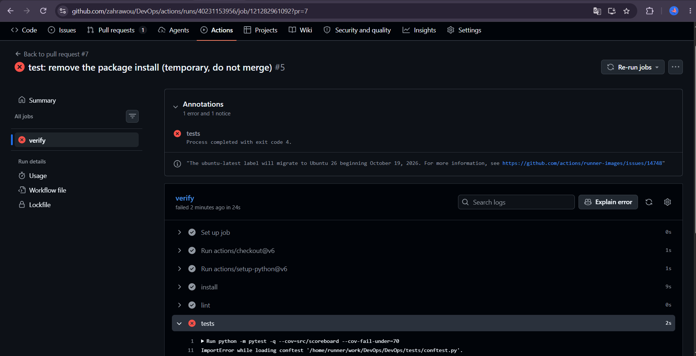
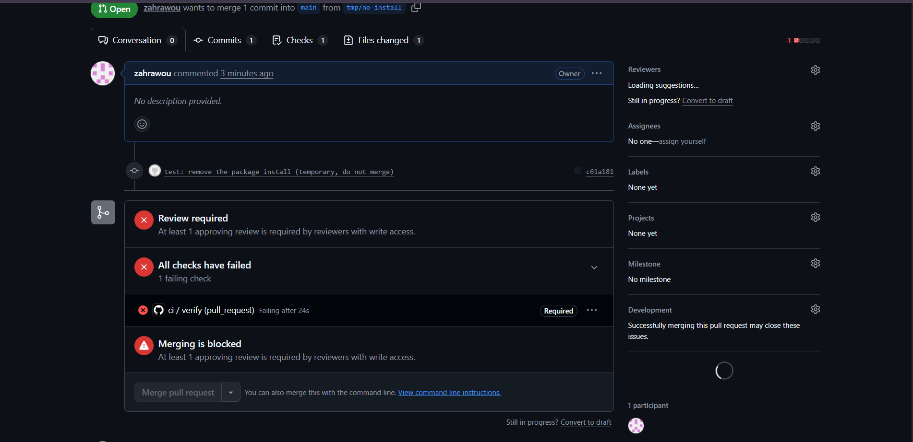
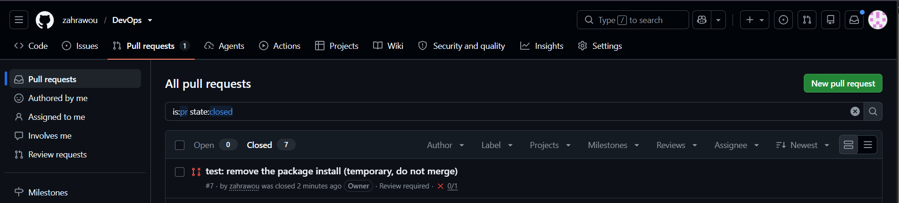
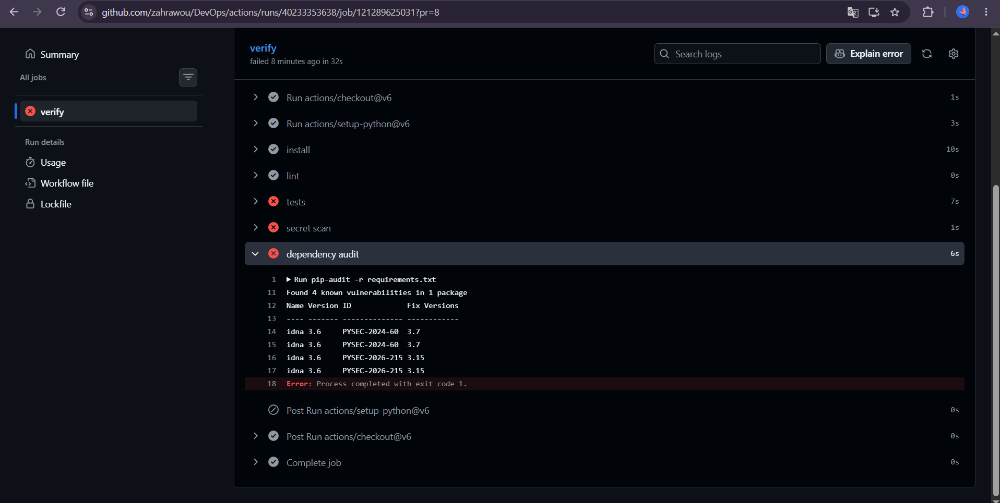
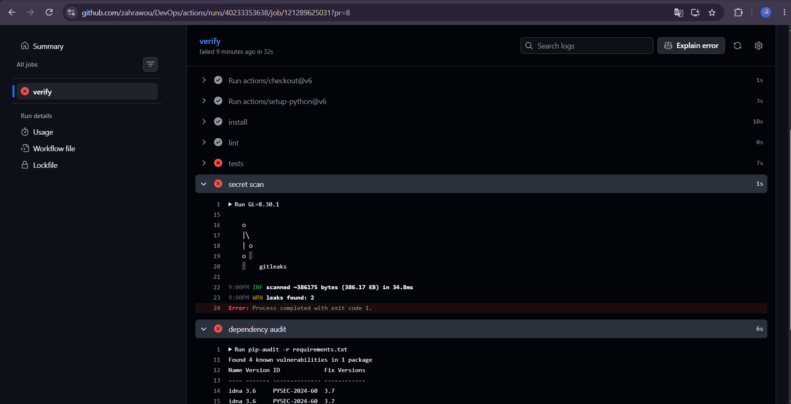
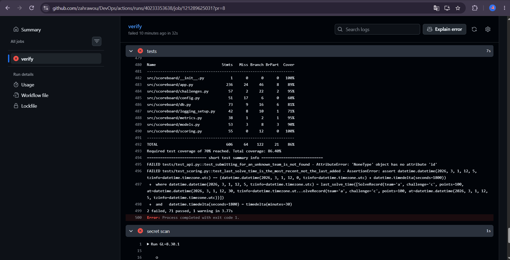
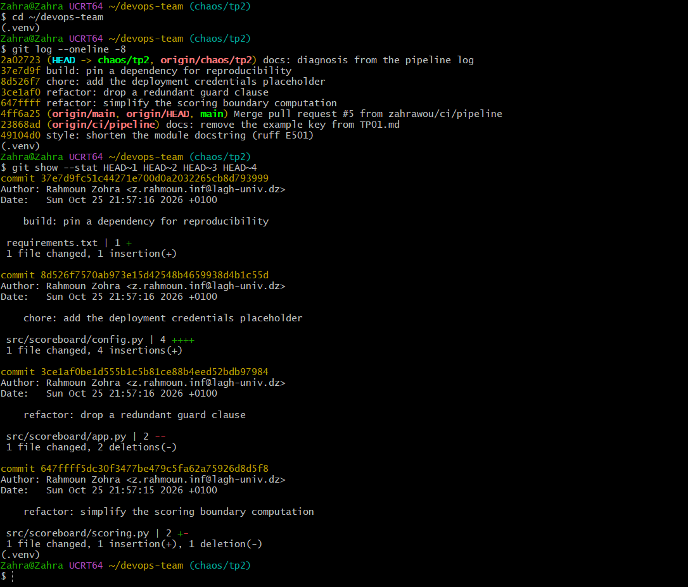
