# TP3 answers

Parts A to D were run on my own machine (Windows 10, Docker Desktop) with the
same Dockerfile and `.dockerignore` as in PR #12. The image is tagged
`scoreboard:1` and `scoreboard:2` instead of `scoreboard:local`. In Part B I ran
the container without `-e ADMIN_TOKEN=dev` (the log shows `admin_enabled: false`);
the smoke test still passes. Part E is the team's pipeline on main.

## Exercise 1

(a) `scoreboard:1`: 266 MB on disk (63.1 MB content). `python:3.12-slim`: 180 MB
on disk (45.5 MB content). The application adds about 86 MB, mostly the 69 MB
virtualenv (`docker history`).

(b) In the build stage but not in the runtime image:
1. the source tree and build files (`requirements.txt`, `pyproject.toml`,
   `README.md`, `src/`);
2. the build-only layers: the `COPY` layers and the two `pip install` layers.
   Only the finished virtualenv `/opt/venv` is copied to the runtime stage.

(c) 1. Without the source and build files, an attacker in the container has less
   to read and nothing to rebuild or change the application with.
2. Without the build layers, the image is smaller and has fewer files that can
   contain vulnerabilities (smaller attack surface).

(d) Dependencies change rarely, source code often. In the second build (one line
added to `app.py`) these steps were CACHED (0.0 s): `COPY requirements.txt` and
`pip install -r requirements.txt` (80.7 s in the first build). Only `COPY src/`
and `pip install .` ran again: 48 s instead of 138 s. With `src/` first, every
code change would download all dependencies again.

## Exercise 2

Output of Part B: `smoke.sh` -> "all good" (12 checks ok);
`docker exec sb id` -> `uid=10001(scoreboard) gid=999(scoreboard)`;
`touch /x` -> `touch: cannot touch '/x': Read-only file system`.

(a) The named volume `sbdata` mounted on `/app/data`. A mount is a separate
filesystem, so it stays writable while the root filesystem is read-only. The
SQLite database is in `/app/data`.

(b) A named volume is managed by Docker, does not depend on a path of the host
and works the same on every machine. A new volume is initialised from the
image's `/app/data`, which was `chown`ed to 10001, so the non-root user can
write to it. A host folder `$PWD/data` depends on the machine, its permissions
may block uid 10001, and it exposes a host folder to the container.

(c) `--cap-drop ALL`: no Linux capabilities, so the attacker cannot change file
ownership, open raw sockets or change the network setup.
`--security-opt no-new-privileges`: he cannot gain privileges through setuid
programs.

## Exercise 3

(a) `time docker stop sb` (uvicorn is PID 1): real 2.7 s.
`time docker stop sb2` (`sh -c` is PID 1): real 4.4 s (4.4 s again in a second run).

(b) `docker stop` sends SIGTERM to PID 1. With the exec form, uvicorn is PID 1,
receives SIGTERM and shuts down by itself. With `sh -c`, the shell is PID 1 and
python is only its child (`docker top sb2`: `sh -c python -m scoreboard; echo
exited` is the parent of `python -m scoreboard`). The shell does not pass
SIGTERM on, so Docker waits for the timeout and then sends SIGKILL. I did not
reach the 10 s timeout on my machine and I did not check the exit code, so I
only measured that `sb2` was about 1.7 s slower; the PID 1 / SIGTERM mechanism
is the explanation, not something I proved here.

(c) In a rolling update of twenty replicas, one after the other, every replica
that does not handle SIGTERM adds its stop delay (up to the 10 s timeout). The
delay is multiplied by twenty, so the update is much longer, and running
requests are cut instead of finished.

## Exercise 4

(a) 2 findings, both HIGH (0 CRITICAL), both in the same package: `zlib1g`
1:1.3.dfsg+really1.3.1-1+b1 (Debian 13.7): CVE-2026-76844 and CVE-2026-85091.
A fixed version exists (1:1.3.dfsg+really1.3.1-1+deb13u1). The 25 Python
package entries (24 distinct packages, `pip` appears twice) have 0 findings.
The title that Trivy shows for CVE-2026-76844 mentions webpack-dev-middleware,
which does not fit zlib1g; I report the table as printed.

(b) `pip-audit` only checks the Python dependencies of `requirements.txt`. Trivy
scans the whole image, including the operating system packages of the base
image. `zlib1g` is a Debian library, so `pip-audit` cannot see it.

(c) A fixed version makes the scan reproducible: the same image gives the same
result and a new scanner cannot change the findings without a review. It is
also supply-chain protection: we run exactly the tool that we checked.

## Exercise 5

(a) `git commit` creates the hash -> GitHub Actions gives it as `github.sha` ->
`build-args: BUILD_SHA` -> Dockerfile `ARG BUILD_SHA` -> `ENV BUILD_SHA` -> the
running process reads it -> the application returns it in `/version`. The same
hash is the tag of the image in GHCR.

The hash of the final commit on main is the one in the submission link.
Screenshot 13 shows the published image returning this same hash in `/version`.

(b) If both versions have the tag `latest`, a node can pull a different image
than expected and nobody knows which version runs. A rollback is impossible,
because `latest` no longer points to the old image. Two replicas started at
different times can run different code under the same tag.

## Screenshots

All images are in docs/screenshots/. Screenshots 00 to 09 were taken during the
lab. In 05 the first smoke test ran before the application was ready (FAIL
liveness); it passed on the second run (screenshot 04). Screenshots 10 to 13 are
GitHub/GHCR evidence.

- tp3-00-docker-ok.png: `docker info`, `hello-world`
- tp3-01-docker-build.png: `docker build -t scoreboard:1 .` (first build, 138 s)
- tp3-01b-dockerfile.png: the `.dockerignore` and the Dockerfile
- tp3-02-images-sizes.png: `docker images` (python:3.12-slim and scoreboard:1)
- tp3-02b-docker-history.png: `docker history scoreboard:1` (venv layer 69 MB)
- tp3-03-cache-rebuild.png: second build with CACHED steps (48 s)
- tp3-04-smoke.png: `smoke.sh` against the hardened container, "all good"
- tp3-05-id-readonly.png: `docker exec sb id` and the read-only error
- tp3-06-stop-times.png: `time docker stop sb` and `sb2`
- tp3-07-docker-top.png: `docker top sb2` (sh is the parent of python)
- tp3-08-trivy.png: Trivy summary (Total: 2, HIGH: 2, zlib1g)
- tp3-08b-trivy-table.png, tp3-08c-trivy-table.png: Trivy report (0 findings in Python packages)
- tp3-09-ci-job.png: the image job added to `ci.yml`, commit and push
- tp3-10-pr-merged.png: pull request with the Dockerfile and the image job
- tp3-11-actions-green.png: run on main, verify and image green
- tp3-12-package-public.png: GHCR package, visibility Public
- tp3-13-version-hash.png: `docker run` of the published image and `/version` (taken after the final commit on main)

[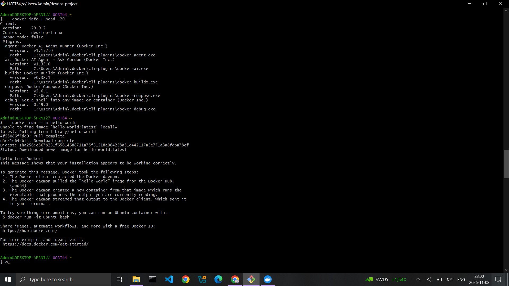](screenshots/tp3-00-docker-ok.png) [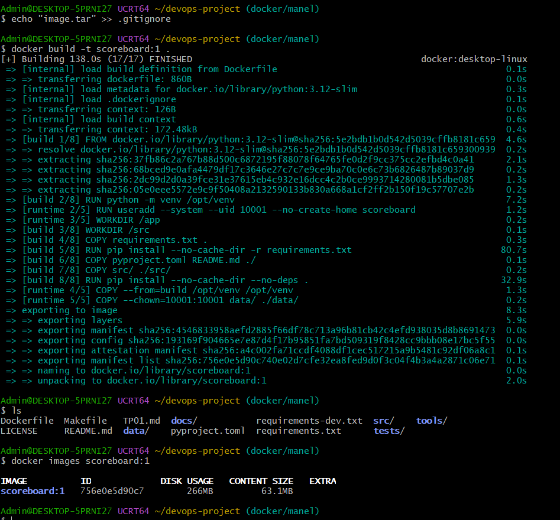](screenshots/tp3-01-docker-build.png) [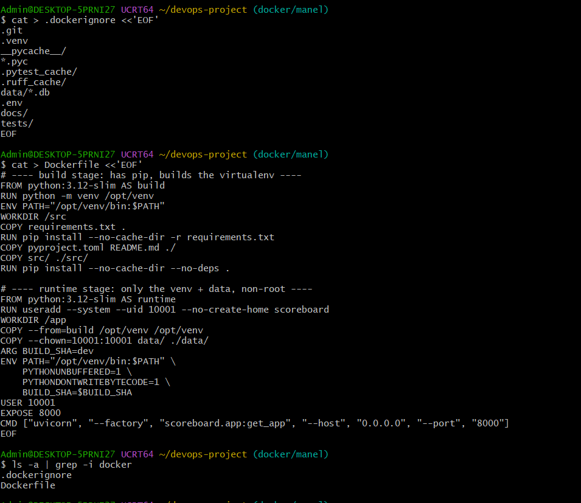](screenshots/tp3-01b-dockerfile.png) [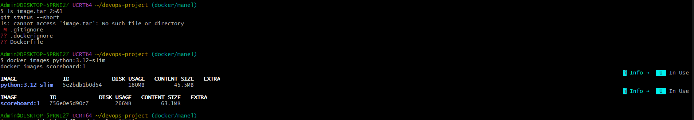](screenshots/tp3-02-images-sizes.png) [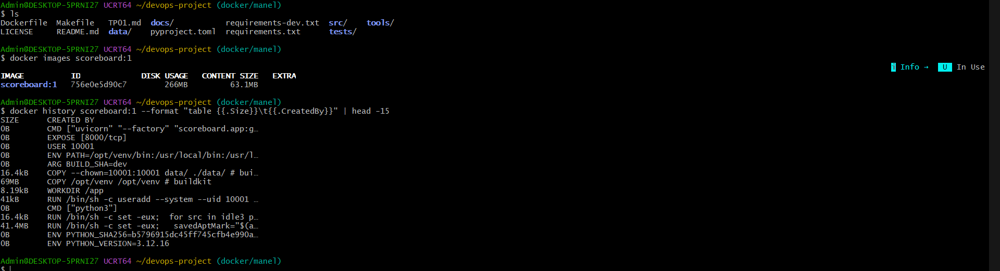](screenshots/tp3-02b-docker-history.png) [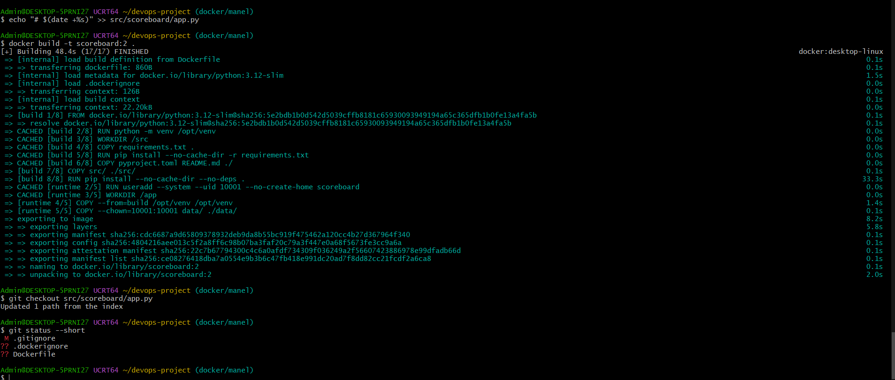](screenshots/tp3-03-cache-rebuild.png) [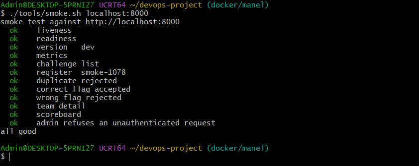](screenshots/tp3-04-smoke.png) [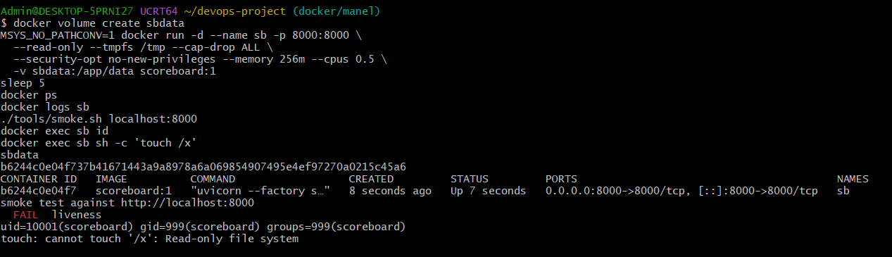](screenshots/tp3-05-id-readonly.png) [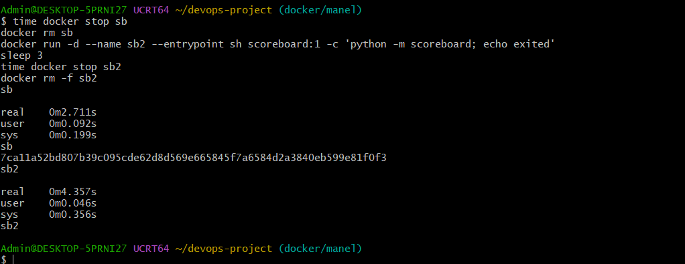](screenshots/tp3-06-stop-times.png) [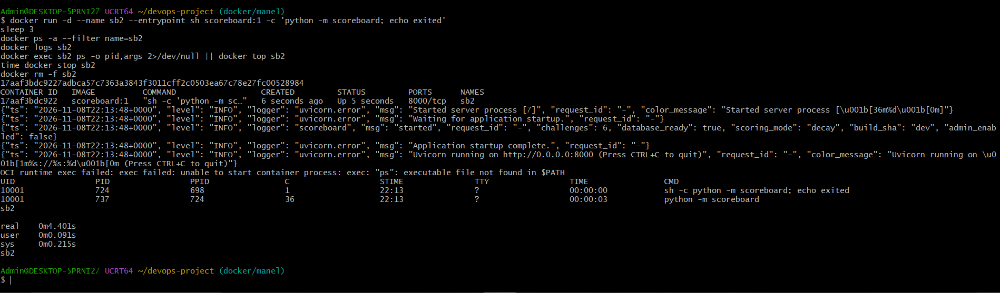](screenshots/tp3-07-docker-top.png) [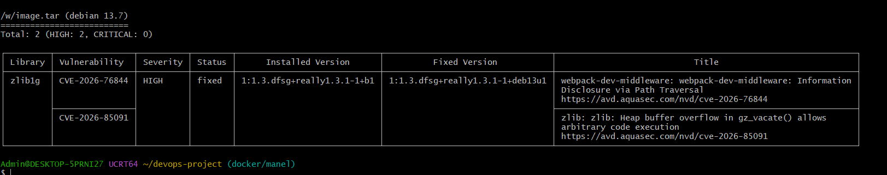](screenshots/tp3-08-trivy.png) [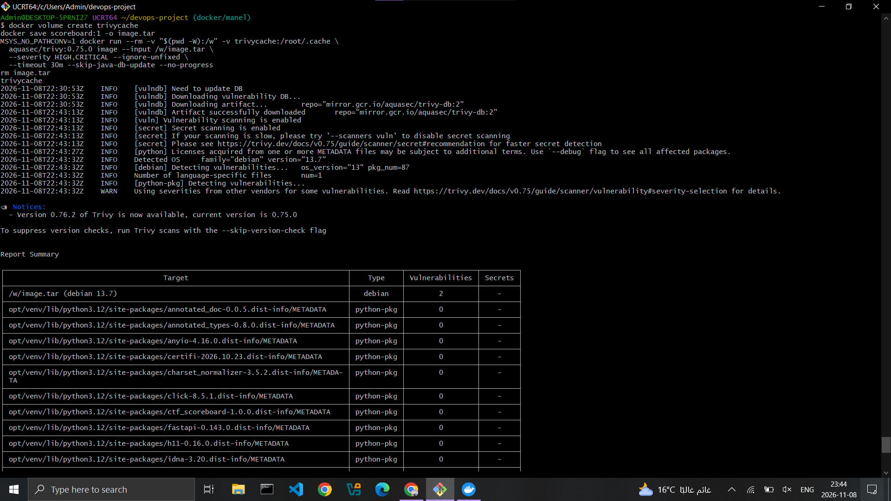](screenshots/tp3-08b-trivy-table.png) [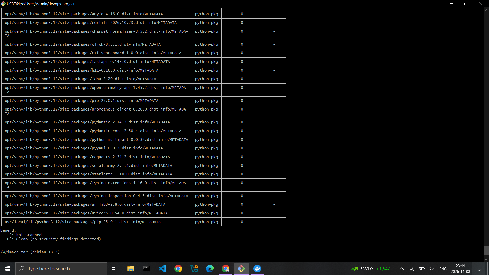](screenshots/tp3-08c-trivy-table.png) [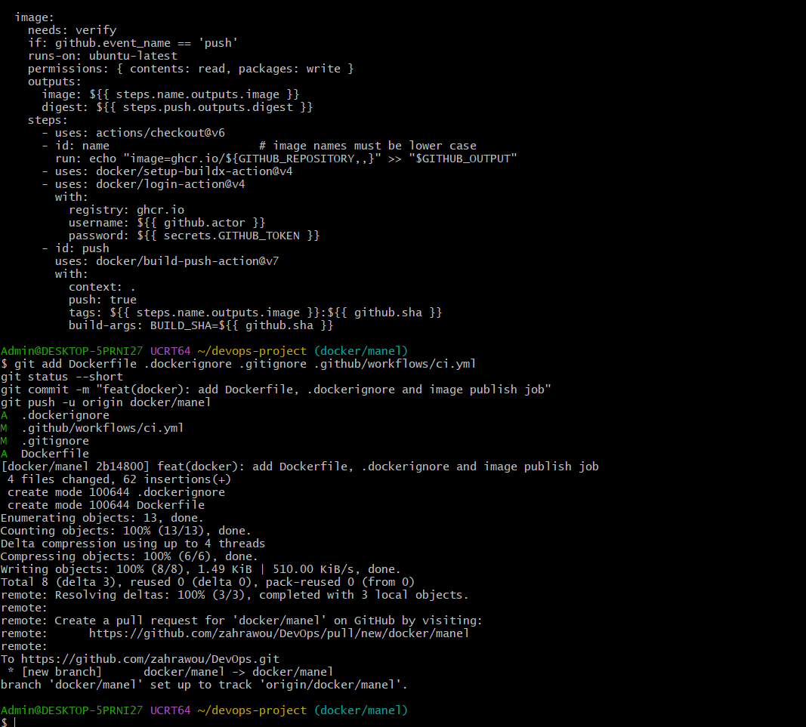](screenshots/tp3-09-ci-job.png) [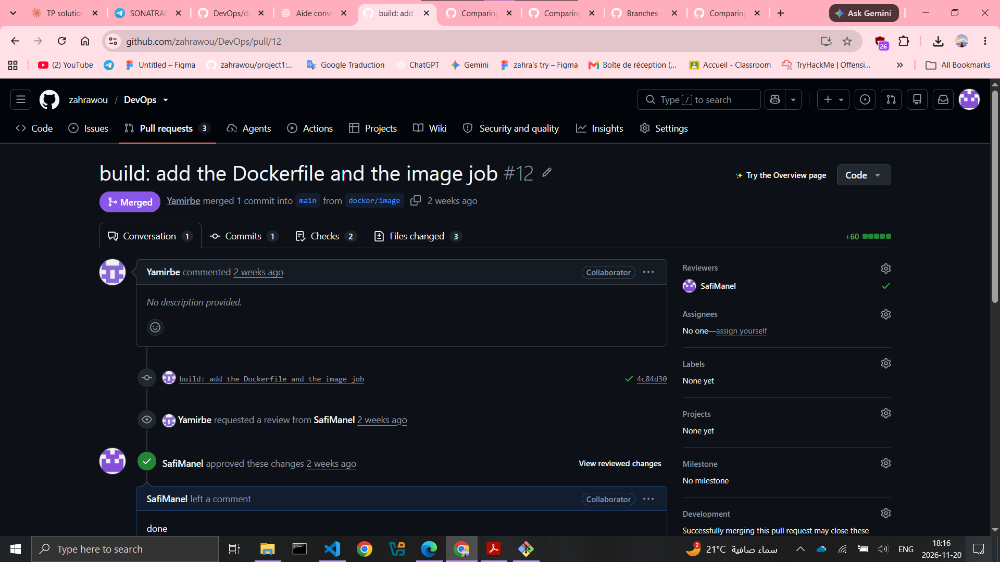](screenshots/tp3-10-pr-merged.png) [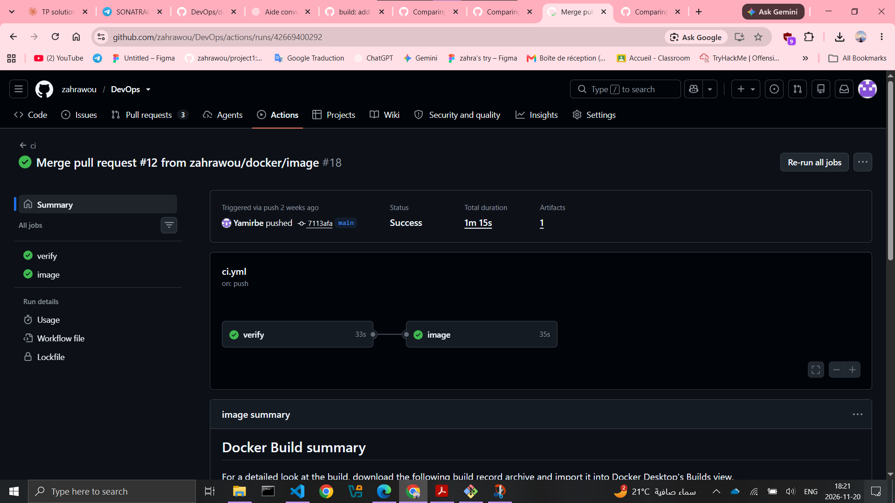](screenshots/tp3-11-actions-green.png) [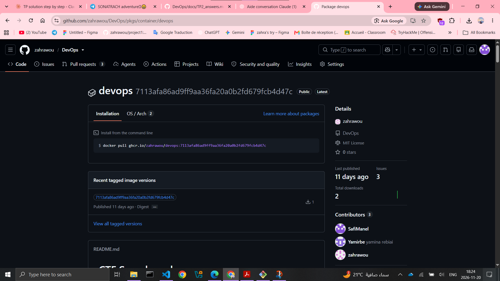](screenshots/tp3-12-package-public.png) [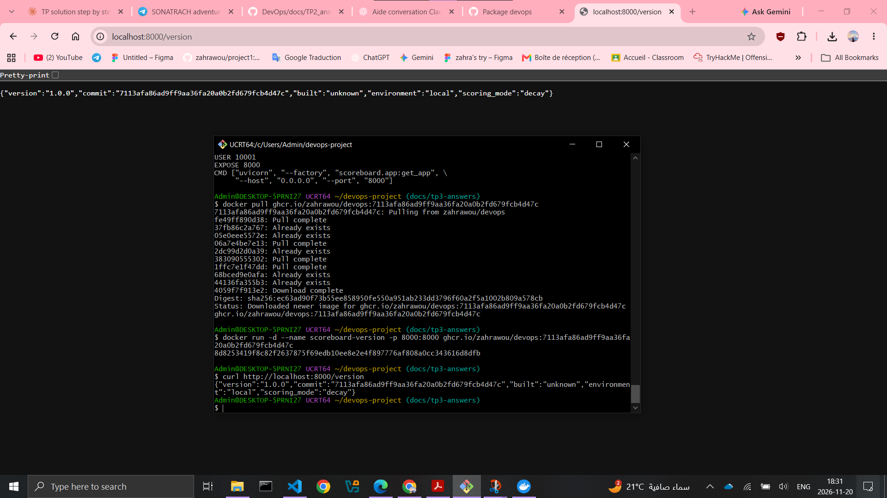](screenshots/tp3-13-version-hash.png)
