# Lab sheet 4: Kubernetes. Answers and evidence

Repository: https://github.com/zahrawou/DevOps
Full name of my image from lab sheet 3 (lower case, public package): `ghcr.io/zahrawou/devops:6e4c303a0fe2960d282d6a335fdb39633edf6332`
Cluster: kind v0.30.0 (node image `kindest/node:v1.34.0`), kubectl v1.34.1, shell: Git Bash on Windows with Docker Desktop.

## Part A: a cluster

I created `cluster/kind.yaml` (one control-plane node, host port 8080 mapped to node port 30080) and the cluster with `kind create cluster --name scoreboard --config cluster/kind.yaml`.

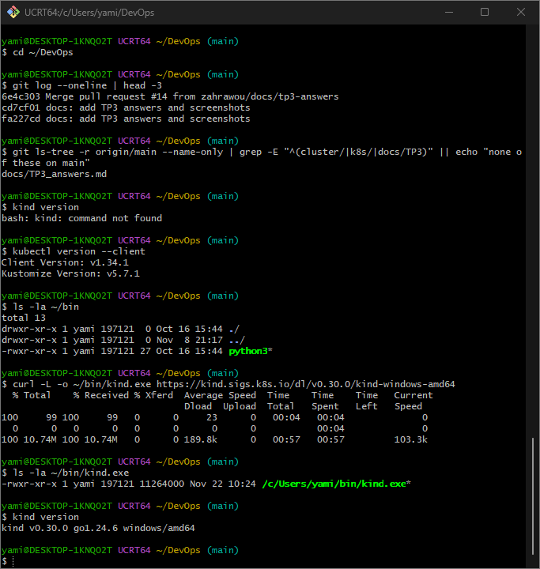

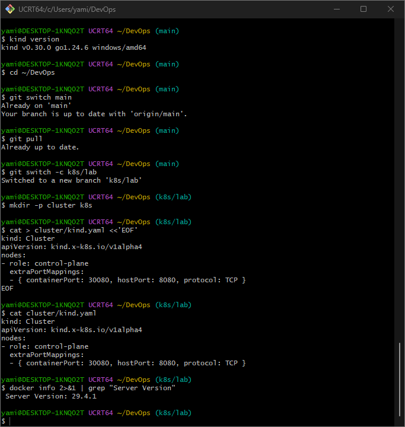

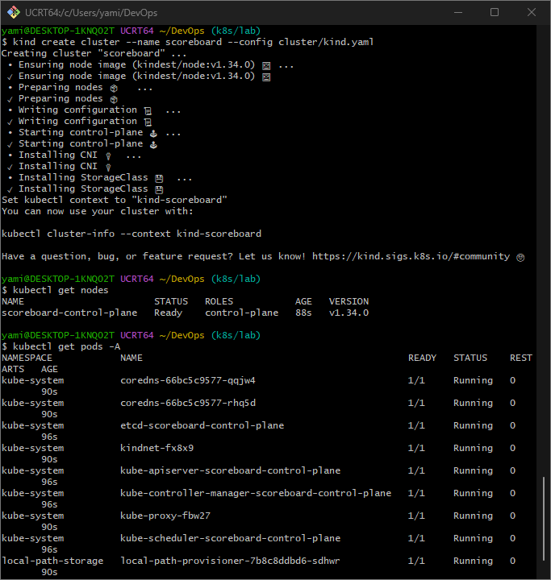

### Exercise 1
- `etcd-scoreboard-control-plane`: without it the cluster has nowhere to store its state (all objects and their desired state), so it forgets everything.
- `kube-apiserver-scoreboard-control-plane`: without it nothing can talk to the cluster, because every kubectl command and every component goes through it.
- `coredns-...`: without it pods cannot resolve service names such as `scoreboard.scoreboard` into IP addresses, so service discovery stops.

## Part B: deploy and reach it

I created `k8s/namespace.yaml`, `k8s/deployment.yaml` (with my image from lab sheet 3) and `k8s/service.yaml`. The admin token was created as a Secret with a command (`openssl rand -hex 24`), so its value is in no file.

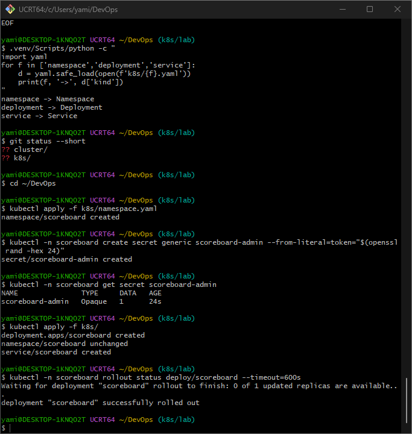

The pod is `1/1 Running`, the smoke test prints `all good` (and `/version` shows the same commit as the image tag), and the EndpointSlice lists one endpoint, `10.244.0.5:8000`.

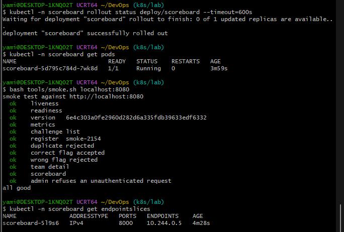

### Exercise 2
I changed the selector of the Service to `app: scoreboard-v2` and applied it.

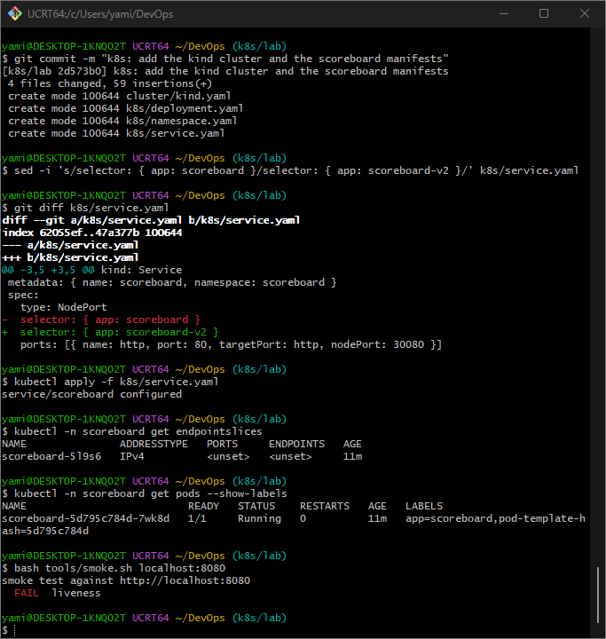

(a) A Service holds a label selector, not a list of pods. Kubernetes continuously matches that selector against the labels of the pods in the same namespace and writes the IP addresses of the matching, ready pods into an EndpointSlice, which the Service uses to route traffic.

(b) After the change the selector asks for `app=scoreboard-v2`, but the only pod has the label `app=scoreboard` (shown by `--show-labels`). No pod matches, so the EndpointSlice shows `<unset>` and the Service has no endpoint, although the pod is still running (the smoke test fails at the first check).

I then put the file back with `git checkout k8s/service.yaml` and applied it again: the endpoint came back and the smoke test printed `all good`.

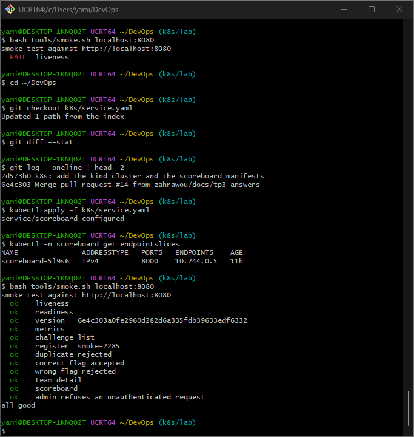

## Part C: readiness is not liveness

### First change: a database path the application cannot create

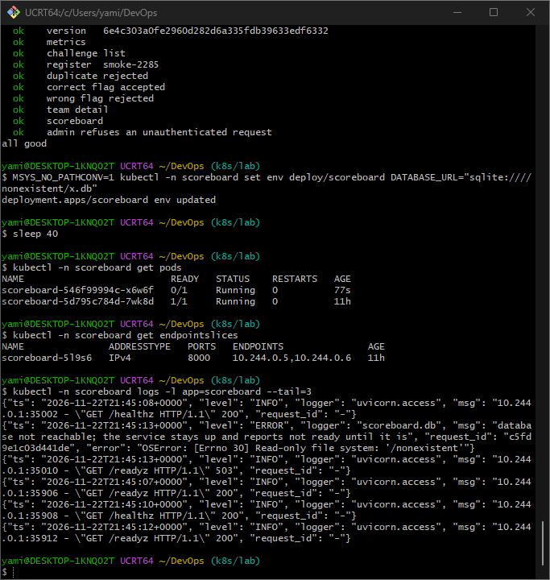

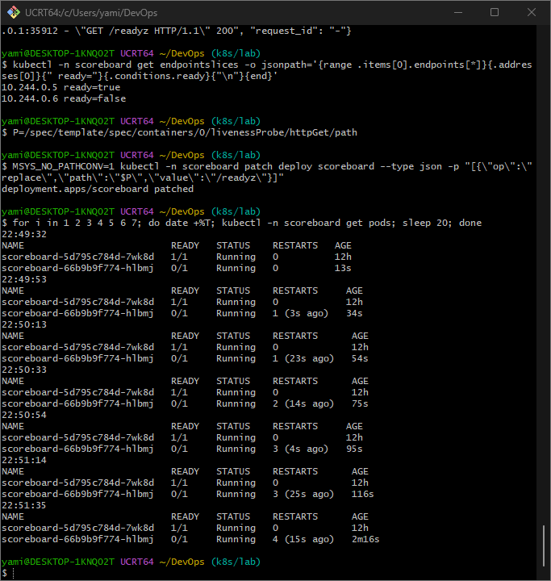

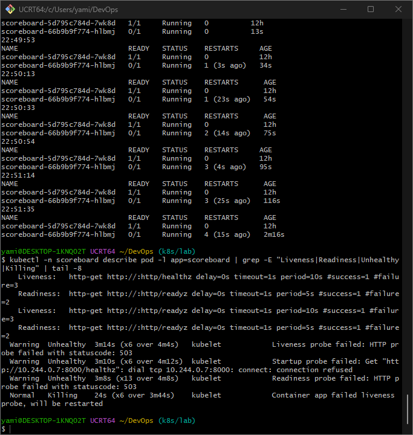

### Second change: liveness also reads /readyz

After that I ran `kubectl apply -f k8s/` to go back to what the files say. The pod list shows only the original healthy pod, the smoke test prints `all good` and `kubectl diff` prints nothing.

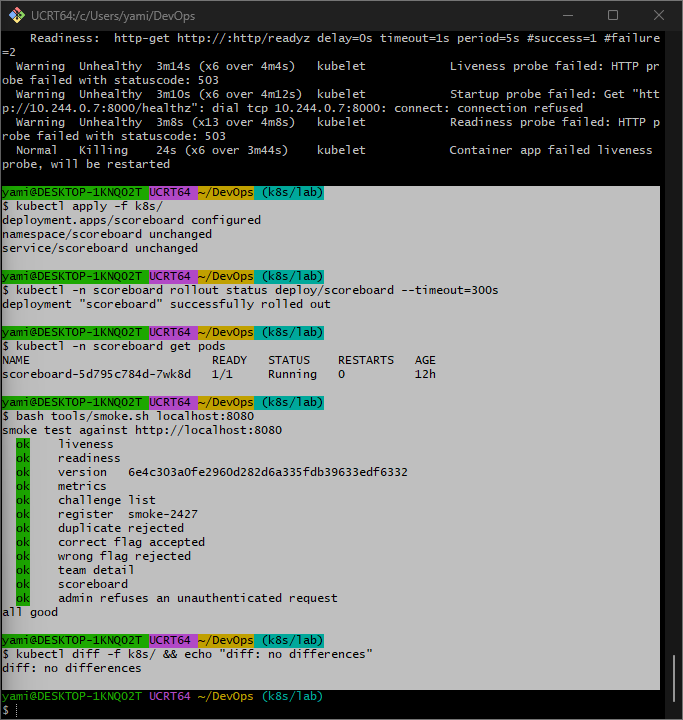

### Exercise 3
(a) After the first change the new pod showed READY `0/1` and RESTARTS `0` (STATUS Running). The old pod stayed `1/1` and kept serving traffic, because the rolling update does not remove it until the new pod is ready. The EndpointSlice listed both IP addresses, but only the old one (`10.244.0.5`) had `ready=true`; the new one (`10.244.0.6`) had `ready=false`.

(b) After the liveness probe was patched to `/readyz`, the new pod had RESTARTS `4` after about two minutes (3 at 1m56s, 4 at 2m16s) and the number kept growing.

(c) The liveness probe reads `/healthz` and the readiness probe reads `/readyz`. In the first configuration `/healthz` does not depend on the database and returns 200, so the pod is not restarted, while `/readyz` returns 503 (the log says the database is not reachable: read-only file system `/nonexistent`), so the pod stays out of the Service. In the second configuration liveness also reads `/readyz`, which returns 503, so the kubelet decides the container is stuck and kills it again and again (events: "Liveness probe failed: HTTP probe failed with statuscode: 503" and "Container app failed liveness probe, will be restarted").

(d) Restarting a container cannot repair a database that is down, so the restarts fix nothing. If every replica checked the database in its liveness probe, all of them would be killed in a loop and none would stay up, and the load of the restarts would make the incident worse. With the first configuration the processes stay alive and recover by themselves when the database comes back.

## Part D: a bad release, and a rollback

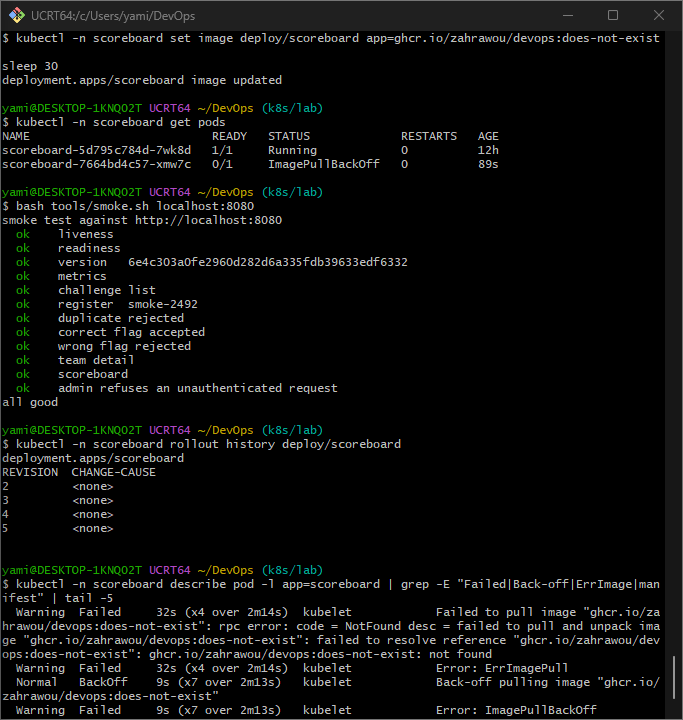

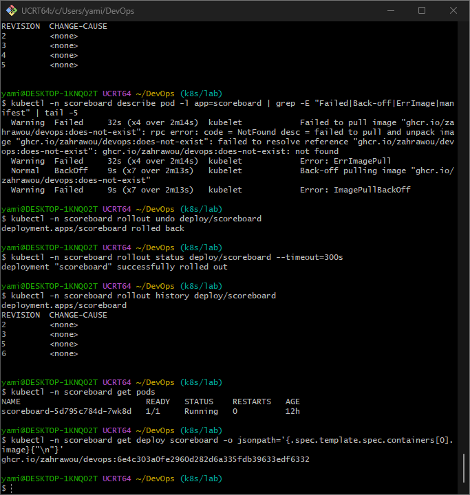

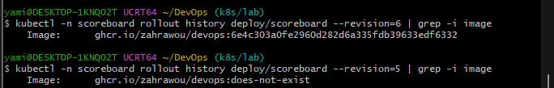

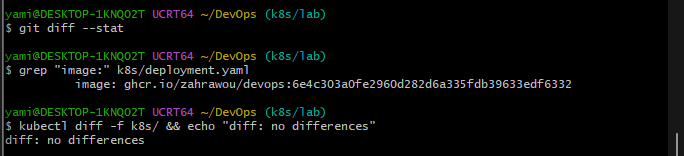

### Exercise 4
(a) The smoke test passed because the new pod never started: its status was `ImagePullBackOff` (`0/1`), since the tag `does-not-exist` is not in the registry (event: failed to resolve reference ... not found). The Deployment's rolling update only removes an old pod when a new pod is ready, so the old pod stayed `1/1 Running` and the Service kept sending traffic to it.

(b) `rollout undo` does not replace Git. It only adds a new revision (6) to the Deployment's rollout history, which re-applies the earlier pod template. Revision 6 shows the `6e4c303...` image, revision 5 shows `does-not-exist` and stays in the list. It leaves no commit, no author and no reason.

(c) `k8s/deployment.yaml` still says `ghcr.io/zahrawou/devops:6e4c303a0fe2960d282d6a335fdb39633edf6332`, because `set image` and `rollout undo` change the cluster and never edit a file (`git diff --stat` printed nothing and `kubectl diff` showed no difference).

## Part E: the files are the truth

I scaled the Deployment to 2 replicas with a direct command. `kubectl diff -f k8s/` then showed the difference between the cluster (`replicas: 2`) and the files (`replicas: 1`), with exit code 1.

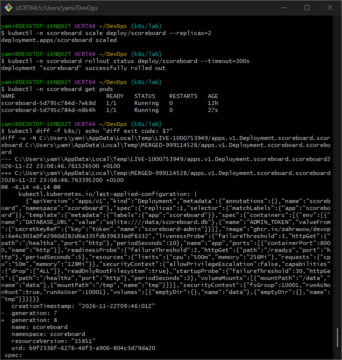

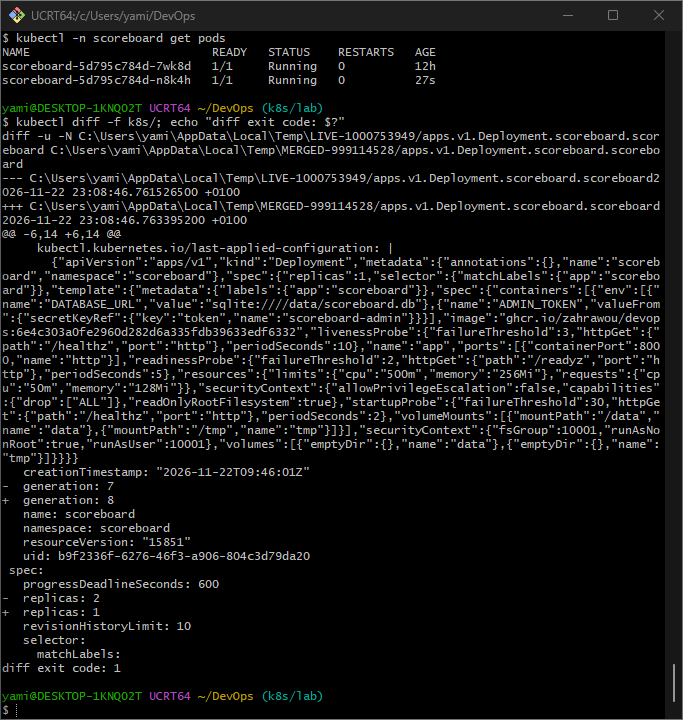

I chose the second option: apply the files again, so the cluster went back to one replica.

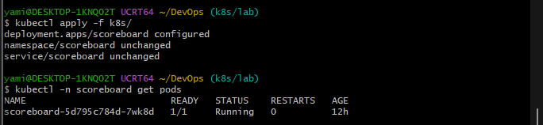

Final check: `git status --short` is clean, `kubectl diff -f k8s/` prints nothing, the smoke test prints `all good`, and `git grep` for "token" only finds the `ADMIN_TOKEN` name and the `secretKeyRef` reference to the Secret, never its value.

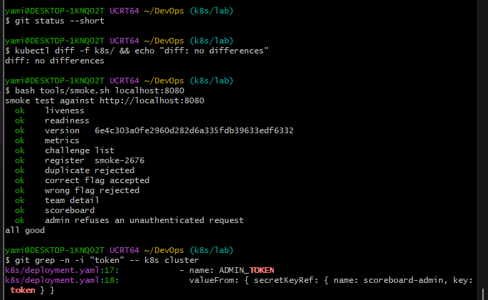

### Exercise 5
(a) None of the four changes. `set env`, `patch`, `set image` and `scale` changed only the live cluster and never wrote to a file, so the repository still says the original image, one replica, and the original database and probe settings. A colleague who reads only the repository would not know they happened.

(b) Argo CD (or Flux). It watches a Git repository and keeps comparing it with the cluster, then applies the repository's version and reverts changes made by hand, so the files really are the source of truth.

## Delivery

The pipeline on the pull request is green (`verify`; the `image` job is skipped on pull requests by design).

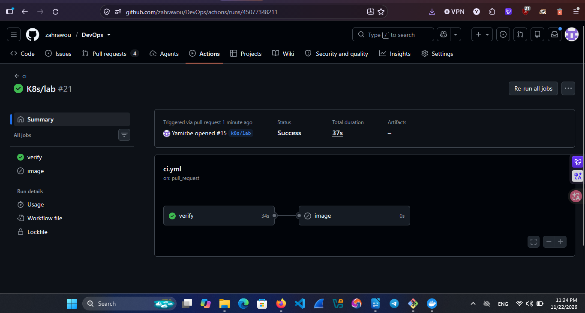

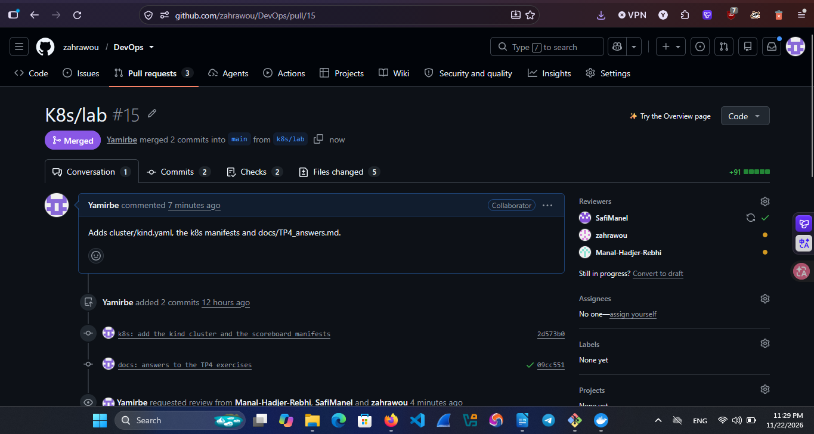

After the merge, `cluster/kind.yaml`, the three files in `k8s/` and the answers file are on `main`, and `kubectl diff -f k8s/` prints nothing.

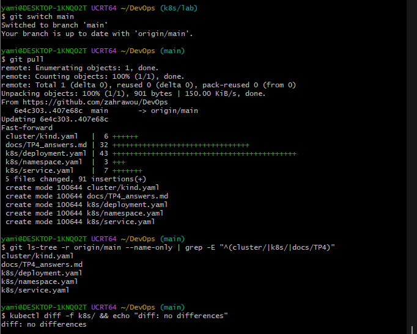
